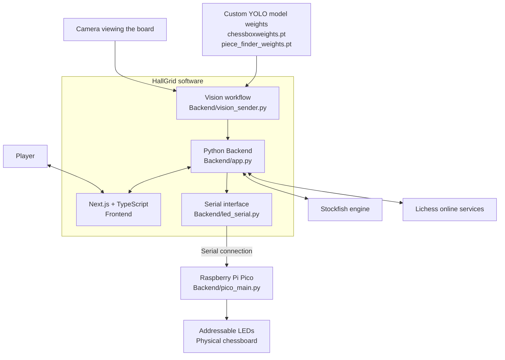

<div align="center">

# HallGrid

### Bridging the physical chessboard and the digital chess experience.

<p>
  <strong>Computer vision · Real-time gameplay · Chess engine integration · Physical LED feedback</strong>
</p>

[](https://www.python.org/)
[](https://nextjs.org/)
[](https://www.typescriptlang.org/)
[](https://www.ultralytics.com/)
[](https://stockfishchess.org/)
[](https://www.raspberrypi.com/products/raspberry-pi-pico/)

<br />

**HallGrid is an AI-enabled physical chessboard project that connects over-the-board play with a modern web application.** By combining camera-based board recognition, a Python backend, chess services, and addressable LED feedback, HallGrid brings digital chess functionality onto a real chessboard.

</div>

---

## Contents

- [What is HallGrid?](#what-is-hallgrid)
- [Features](#features)
- [System architecture](#system-architecture)
- [How the system works](#how-the-system-works)
- [Technology stack](#technology-stack)
- [Repository structure](#repository-structure)
- [Project components](#project-components)
- [Getting started](#getting-started)
- [Running the project](#running-the-project)
- [Hardware setup](#hardware-setup)
- [Configuration and credentials](#configuration-and-credentials)
- [Development notes](#development-notes)
- [Troubleshooting](#troubleshooting)
- [License](#license)

---

## What is HallGrid?

HallGrid is designed to make a physical chessboard an interactive part of a connected chess system rather than a standalone board. A camera observes the board, custom-trained YOLO models support the vision pipeline, and the Python backend coordinates the application-side functionality. A Next.js and TypeScript frontend provides the digital interface, while a Raspberry Pi Pico drives the board's addressable LEDs through a serial connection.

The project brings together several different domains:

- **Physical chess:** play using a real board and real pieces.
- **Computer vision:** use camera input and custom model weights to interpret the board and its pieces.
- **Digital interaction:** connect the physical board to a browser-based chess interface.
- **Engine-powered chess:** integrate Stockfish for computer-play and evaluation functionality.
- **Online chess:** connect to Lichess for online gameplay.
- **Physical feedback:** send commands to a Raspberry Pi Pico to illuminate squares and communicate move-related information through LEDs.
- **Training:** provide chess-training experiences through the frontend, including Puzzle Rush.

HallGrid is maintained as a two-part repository: a Python-based `Backend/` and a Next.js-based `Frontend/`, with the Pico-side program and model weights included in the backend directory.

## Features

### Camera-based board and piece recognition

The backend includes two custom YOLO model-weight files:

- `chessboxweights.pt`
- `piece_finder_weights.pt`

The vision workflow is implemented in `Backend/vision_sender.py`. It works with the model assets to process camera input and provide vision information to the rest of the system. The quality of recognition depends on the camera setup, board positioning, lighting, and the model/inference configuration.

### Python backend

`Backend/app.py` is the main backend application. It brings together the server-side functionality required by the HallGrid application and coordinates communication with the other parts of the system.

The backend directory also contains the vision workflow, model assets, and the host-side serial interface used by the physical LED subsystem.

### Stockfish integration

HallGrid includes Stockfish-based chess functionality for engine play and position evaluation. The engine itself is a separate runtime dependency and must be available in the development environment in the form expected by the application.

The frontend contains `Frontend/stockfish.d.ts`, a TypeScript declaration file associated with Stockfish-related frontend code. This declaration file is not the Stockfish engine binary.

### Lichess online gameplay

HallGrid supports a Lichess-connected online-play workflow. A locally configured Lichess access token is used for authenticated access. The credential must remain private and should never be committed to Git or exposed in browser-side code.

### Addressable LED feedback

The project connects software-side chess information to LEDs on the physical board:

- `Backend/led_serial.py` provides the Python-side serial interface.
- `Backend/pico_main.py` contains the program intended to run on the Raspberry Pi Pico.
- The Pico controls the connected addressable LEDs to provide physical visual feedback.

The host-side and Pico-side implementations must use the same serial command protocol and LED indexing/layout.

### Next.js chess interface

The frontend is built with Next.js and TypeScript. Its visible project structure separates application routes/screens, reusable UI components, and static public assets:

- `Frontend/app/`
- `Frontend/components/`
- `Frontend/public/`

The web interface includes the project's chess experiences, such as physical-board interaction, Stockfish functionality, Lichess gameplay, and Puzzle Rush.

---

## System architecture

HallGrid can be understood as four cooperating layers: the **web client**, the **Python backend**, the **vision and chess integrations**, and the **physical board hardware**.



The diagram represents the high-level relationships between project components. It does not prescribe particular API routes, socket event names, ports, serial settings, or wiring; those details are defined by the implementation and local hardware configuration.

## How the system works

### 1. From the physical board to the application

1. A camera captures the chessboard and its pieces.
2. `Backend/vision_sender.py` handles the camera/vision workflow.
3. The vision pipeline uses the project's custom YOLO model weights.
4. Vision information is passed to the Python backend for application-side processing.
5. The frontend can present the corresponding digital board or game information.

### 2. From the application to the player

1. The player interacts with the HallGrid web interface.
2. The Next.js frontend communicates with the Python backend.
3. The backend coordinates the functionality required by the selected chess mode or physical-board workflow.
4. The frontend displays the relevant game and board information.

### 3. Engine-based chess

1. The application uses the Stockfish engine when engine functionality is requested.
2. Stockfish provides engine responses and/or position evaluation.
3. HallGrid presents the relevant engine-powered functionality through its interface.

The executable location and engine settings are installation-specific and should be taken from the backend/frontend configuration rather than assumed to be the same on every machine.

### 4. Online gameplay

1. The application uses the configured Lichess credentials to access the online-play functionality.
2. Online game information is handled by the HallGrid application.
3. The frontend presents the online game as part of the HallGrid experience.

No separate `interactive_sender.py` file appears in the repository structure shown below. The README therefore does not document it as a required standalone process; consult the current implementation in `Backend/app.py` and the frontend before changing the online-game startup flow.

### 5. From digital instructions to physical LEDs

1. The application determines the LED feedback required by the current board/game state.
2. `Backend/led_serial.py` sends the corresponding data over the configured serial connection.
3. The Raspberry Pi Pico runs the program in `Backend/pico_main.py`.
4. The Pico controls the addressable LEDs connected to the physical chessboard.

---

## Technology stack

| Area | Technology / component | Purpose |
|---|---|---|
| Frontend framework | [Next.js](https://nextjs.org/) | Web application and page structure. |
| Frontend language | [TypeScript](https://www.typescriptlang.org/) | Typed frontend development. |
| Backend language | [Python](https://www.python.org/) | Backend application and integration logic. |
| Computer vision | YOLO-based models | Board and piece recognition workflow. |
| Model assets | PyTorch `.pt` files | Custom detection model weights. |
| Chess engine | [Stockfish](https://stockfishchess.org/) | Engine play and position evaluation. |
| Online chess | [Lichess](https://lichess.org/) | Online gameplay integration. |
| Microcontroller | Raspberry Pi Pico | Physical LED control. |
| Hardware communication | Serial | Communication between the Python host and the Pico. |

> **Version information:** Exact Python, Node.js, Next.js, and package versions should be taken from the project's dependency manifests and runtime configuration. They are not inferred here.

## Repository structure

The following tree reflects the files and directories visible in the repository screenshots. The contents *inside* `Frontend/app/`, `Frontend/components/`, and `Frontend/public/` are not expanded because their nested files were not shown.

```text
Hallgrid/
│
├── Backend/
│   ├── app.py                    # Main Python backend application
│   ├── chessboxweights.pt        # Custom YOLO model weights
│   ├── led_serial.py             # Host-side serial communication for LEDs
│   ├── pico_main.py              # Raspberry Pi Pico-side LED program
│   ├── piece_finder_weights.pt  # Custom YOLO model weights
│   └── vision_sender.py          # Camera / computer-vision workflow
│
└── Frontend/
    ├── app/                      # Next.js application routes and screens
    ├── components/               # Reusable frontend components
    ├── public/                   # Static assets
    ├── eslint.config.mjs         # ESLint configuration
    ├── next-env.d.ts             # Next.js TypeScript environment types
    ├── next.config.ts             # Next.js configuration
    ├── package-lock.json         # Locked npm dependency tree
    ├── package.json              # Frontend dependencies and scripts
    ├── postcss.config.mjs        # PostCSS configuration
    └── stockfish.d.ts             # TypeScript declarations for Stockfish-related code
```

### Backend file guide

| File | Description |
|---|---|
| `Backend/app.py` | Main Python application entry point. It is the central backend file visible in the repository. |
| `Backend/vision_sender.py` | Camera and computer-vision workflow that uses the project's model assets. |
| `Backend/chessboxweights.pt` | Custom YOLO model-weight asset. |
| `Backend/piece_finder_weights.pt` | Custom YOLO model-weight asset. |
| `Backend/led_serial.py` | Python-side serial communication with the LED controller. |
| `Backend/pico_main.py` | Program intended for the Raspberry Pi Pico to control the board LEDs. |

### Frontend file guide

| File / directory | Description |
|---|---|
| `Frontend/app/` | Next.js application routes, pages, and application-level UI. |
| `Frontend/components/` | Reusable React components. |
| `Frontend/public/` | Static assets served by the frontend. |
| `Frontend/package.json` | Frontend dependencies and npm scripts. |
| `Frontend/package-lock.json` | Exact dependency resolution for reproducible npm installation. |
| `Frontend/next.config.ts` | Next.js configuration. |
| `Frontend/next-env.d.ts` | Type declarations generated/used by Next.js. |
| `Frontend/eslint.config.mjs` | ESLint configuration. |
| `Frontend/postcss.config.mjs` | PostCSS configuration. |
| `Frontend/stockfish.d.ts` | TypeScript declarations for Stockfish-related imports or APIs. |

---

## Getting started

HallGrid requires separate setup for the Python backend, the Next.js frontend, and the physical hardware. The commands below use the directory names shown in the repository structure.

### Prerequisites

**Software**

- Python 3 installed and available on your command line.
- Node.js and npm installed.
- Git.
- The Python packages required by the backend and vision code.
- A compatible Stockfish engine installation for the engine functionality.
- A Lichess access token for authenticated online-play functionality.
- The runtime/tooling required to deploy and run the Pico-side program.

**Hardware**

- A physical chessboard and chess pieces.
- A camera positioned to observe the board.
- A Raspberry Pi Pico.
- Compatible addressable LEDs and the required wiring/power arrangement.
- A serial connection between the host computer and the Pico.

### 1. Clone the repository

```bash
git clone <repository-url>
cd Hallgrid
```

Use the actual repository URL and preserve the directory name created by Git.

### 2. Set up the backend environment

From the repository root:

```bash
cd Backend
python -m venv .venv
```

Activate the environment.

**Windows PowerShell**

```powershell
.venv\Scripts\Activate.ps1
```

**macOS / Linux**

```bash
source .venv/bin/activate
```

Install the Python dependencies required by the backend. The `Backend/` directory listing provided for this README does not show a `requirements.txt`, `pyproject.toml`, or other Python dependency manifest, so an exact installation command cannot be specified reliably. Check the imports in `app.py`, `vision_sender.py`, and `led_serial.py`, or add and maintain a dependency manifest for repeatable setup.

### 3. Install frontend dependencies

Open another terminal and run:

```bash
cd Frontend
npm ci
```

`npm ci` uses the committed `package-lock.json` to install the dependency tree. To see the scripts available in this project, run:

```bash
npm run
```

For a standard Next.js development setup, the development server is commonly started with `npm run dev`; use the script actually defined in `Frontend/package.json`.

### 4. Configure local credentials and settings

Configure the values required by the source code on your machine. This may include:

- Lichess access token.
- Backend/frontend connection settings.
- Stockfish executable location, if required by the implementation.
- Camera device selection.
- Serial port and communication settings for the Pico.
- Model file locations, if the code does not resolve them relative to its own directory.

The screenshots do not show an environment template or reveal the exact variable names. Check the source code for the names it reads. Do not invent variable names or place private credentials in source files.

---

## Running the project

The backend and frontend are separate applications and should be started in separate terminals. Hardware-dependent features also require the camera and Pico to be connected and configured.

### Start the backend

From the repository root:

```bash
cd Backend
python app.py
```

This starts the Python application using the visible backend entry point. Any required Python dependencies and local configuration must already be installed/set up.

### Start the vision process

If the vision workflow is intended to run as a separate process in your setup, open another terminal:

```bash
cd Backend
python vision_sender.py
```

Ensure the camera is available and that the model paths used by the script point to the `.pt` files in `Backend/`.

### Start the frontend

Open another terminal:

```bash
cd Frontend
npm run dev
```

Use the development script defined in `Frontend/package.json`. Once started, Next.js prints the local address in the terminal. The frontend's backend connection configuration must target the running Python application.

### Start the LED controller

Deploy `Backend/pico_main.py` to the Raspberry Pi Pico using the microcontroller workflow supported by the code. Keep the Pico connected over the expected serial interface while the Python application is communicating with it.

> **Note:** The repository screenshots show the relevant entry-point files, but do not show their internal code or package scripts. Treat the launch commands as the expected starting points and verify any project-specific arguments, working-directory assumptions, and process dependencies in the source before relying on them.

---

## Hardware setup

The LED subsystem creates a connection between the software state and the physical chessboard.

| Layer | Component | Responsibility |
|---|---|---|
| Host application | `Backend/app.py` | Coordinates application-side behavior. |
| Serial interface | `Backend/led_serial.py` | Communicates with the LED controller over serial. |
| Microcontroller | Raspberry Pi Pico | Receives host commands and controls the LEDs. |
| Pico program | `Backend/pico_main.py` | Implements the Pico-side behavior. |
| Physical output | Addressable LEDs | Displays the requested visual feedback on the board. |

For reliable operation, keep the following consistent between the host code and the Pico program:

- Serial port and baud rate.
- Message/command format.
- LED count and indexing convention.
- Mapping between LED indices and chessboard squares.
- Board orientation and coordinate convention.
- Power requirements and wiring for the LED hardware.

A change to the serial protocol or square-to-LED mapping may require corresponding updates on both the Python and Pico sides.

## Configuration and credentials

Keep machine-specific configuration and secrets out of committed source files. Depending on how the current code is configured, local settings may include:

| Configuration | Why it is needed | Handling |
|---|---|---|
| Lichess access token | Authenticates online-play requests. | Store locally; never commit or expose it in frontend code. |
| Backend URL / port | Lets the frontend reach the Python backend. | Configure for the local environment. |
| Stockfish executable path | Locates the chess engine. | Use a path valid on the current operating system. |
| Camera device | Selects the camera used by the vision process. | Configure for the connected device. |
| Serial port / baud rate | Connects the host computer to the Pico. | Keep consistent with the Pico program. |
| Model paths | Locate the custom `.pt` weights. | Ensure paths resolve from the script's working directory. |

Before pushing changes, review staged files and the Git history for accidentally committed credentials. Removing a secret from the latest version does not remove it from previous commits. Revoke and replace credentials that have been exposed.

## Development notes

- **Run components independently while debugging.** Test the frontend, backend, vision process, and LED hardware separately before debugging the full end-to-end experience.
- **Keep paths predictable.** Resolve model and engine paths consistently so that commands work from the repository root as well as from component directories where supported.
- **Keep the serial protocol synchronized.** Host-side and Pico-side changes should be tested together.
- **Treat model weights as project assets.** If the `.pt` files become too large for normal Git hosting, consider Git LFS or another model-artifact storage solution.
- **Keep dependencies reproducible.** A Python dependency manifest would make backend setup easier for collaborators; the frontend already includes `package-lock.json` in the shown structure.
- **Document environment variables.** An example environment file with placeholder values can make setup easier without exposing secrets.
- **Do not assume unlisted files exist.** The repository tree in this README is based on the supplied GitHub directory screenshots. Update it when files are added, renamed, or removed.

## Troubleshooting

| Problem | Checks to perform |
|---|---|
| Frontend loads but cannot reach the backend. | Confirm the Python application is running and that the frontend is configured with the correct backend address and port. |
| Backend fails during startup. | Check the Python version, installed dependencies, configuration values, and paths used by `Backend/app.py`. |
| Camera is not detected. | Check camera connection, permissions, device selection, and whether another process is using the camera. |
| Vision process cannot load a model. | Confirm both `.pt` files are present and that the paths used by `vision_sender.py` resolve correctly. |
| Board or piece detection is unreliable. | Check camera angle, focus, lighting, board placement, and that the intended model weights and inference settings are being used. |
| Stockfish functionality is unavailable. | Verify that the Stockfish engine is installed and that the application points to a valid executable. Remember that `stockfish.d.ts` is a TypeScript declaration file, not the engine binary. |
| Lichess authentication fails. | Confirm that the token is valid, has the permissions required by the integration, and is being read from the expected local configuration. |
| Online game information does not update. | Check the backend/frontend connection, the Lichess session, and the online-game handling code in the current implementation. |
| LEDs do not respond. | Check Pico power, firmware/program status, serial port, baud rate, command format, LED wiring, and the square-to-LED mapping. |

When debugging, isolate the failure by testing one boundary at a time: device or external service, local script, backend coordination, and finally frontend display.

---

## License

**No license has currently been specified for HallGrid.** This repository does not claim to be released under the MIT License or any other open-source license.

Until a license is added, others should not assume that they have permission to reuse, modify, or redistribute the project's code or assets. To publish the project under an open-source license, add a `LICENSE` file containing the license you choose and ensure that you have the rights to license all included code, model weights, and other assets.

---

<div align="center">

**HallGrid — bringing physical and digital chess together.**

</div>
